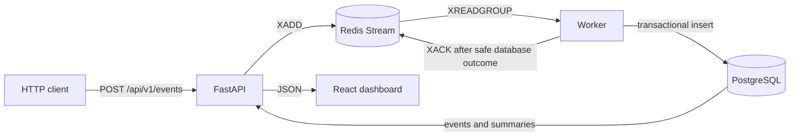

# EventStream

EventStream is a compact metrics pipeline that demonstrates validated HTTP ingestion,
asynchronous Redis Stream processing, idempotent PostgreSQL persistence, and a React dashboard
driven by real query results.

## Architecture



The API returns `202 Accepted` after Redis accepts a validated event. Persistence happens later:
the worker commits a new row, or confirms the result of a duplicate identifier, before it
acknowledges the stream message. PostgreSQL is the query system of record; the dashboard never
substitutes mocked values for failed API requests.

See [the architecture guide](docs/architecture.md) for the detailed sequence, invariants, and
failure boundaries.

## Stack

- Python 3.14.6, uv, FastAPI, Pydantic v2, SQLAlchemy 2, Alembic, psycopg 3, and redis-py
- PostgreSQL 17 and Redis 7.4 Streams
- React 19, TypeScript, Vite, TanStack Query, Recharts, Vitest, and Testing Library
- Ruff, mypy, pytest, pnpm, Docker Compose, and GitHub Actions

## Quick start

Prerequisites are Python 3.14.6 through uv, Node.js 22+, pnpm 10+, Docker Desktop with Compose,
and `make`.

```bash
cp .env.example .env
make setup
docker compose up --build
```

Compose starts PostgreSQL, Redis, the API, worker, and frontend. The API applies Alembic
migrations before starting. Services are published on loopback only.

| Resource | URL |
| --- | --- |
| Dashboard | <http://localhost:5173> |
| OpenAPI UI | <http://localhost:8000/docs> |
| Liveness | <http://localhost:8000/health/live> |
| Readiness | <http://localhost:8000/health/ready> |

Stop the stack without removing its named volumes:

```bash
make down
```

The checked-in configuration contains local-development credentials only. Root `.env` values
are loaded by Compose and directly run Python processes; Make variables must be overridden on
the command line or exported in the shell.

## Metric contract

Every request requires a client-generated `event_id`, a normalized service name, a supported
metric, a finite metric value, a timezone-aware timestamp, and schema version `1`.

| Metric | Unit | Accepted value |
| --- | --- | --- |
| `latency_ms` | milliseconds | 0 through 86,400,000 |
| `request_count` | count | whole numbers from 0 through 1,000,000,000 |
| `error_count` | count | whole numbers from 0 through 1,000,000,000 |
| `cpu_usage` | percent | 0 through 100 |
| `memory_usage` | percent | 0 through 100 |

Services are trimmed and lowercased before the final 128-character limit is checked. Services,
tag keys, and tag values cannot contain NUL characters. Timestamps are normalized to UTC. Requests
may contain up to 20 string tags; keys are limited to 64 characters and values to 256 characters.

The API enforces the complete request contract. PostgreSQL independently checks the supported
metric names, per-metric ranges and count integrality, schema version `1`, lowercase nonempty
services without leading or trailing POSIX whitespace, and object-shaped JSONB tags. Column types,
nullability, service length, and the unique `event_id` add storage protections; tag count and tag
key/value content and length rules, plus client timestamp-awareness, remain API rules. The
contract-enforcement migration checks this persisted subset against legacy rows first.
If any violate it, the migration fails explicitly without altering or deleting event data; those
rows must be inspected and corrected deliberately before it is rerun.

## API and retry semantics

Submit one event with a stable identifier:

```bash
curl --fail-with-body -X POST http://localhost:8000/api/v1/events \
  -H 'Content-Type: application/json' \
  -d '{
    "event_id": "018f62d0-65f2-7b3f-8c2d-72e981985c3a",
    "service": "checkout",
    "metric_name": "latency_ms",
    "value": 84.2,
    "timestamp": "2026-08-09T18:00:00Z",
    "tags": {"environment": "local"},
    "schema_version": 1
  }'
```

`202 Accepted` means Redis accepted the event, not that PostgreSQL already contains it. A Redis
publication failure returns `503`; validation failures return `422`.

For a retry, send the same complete payload with the same `event_id`. Redis may receive another
entry, but the database keeps one canonical row. Reusing that identifier with different client
fields is an idempotency conflict: it is detected asynchronously by the worker, the original row
is preserved, and the permanently invalid message is logged and acknowledged. Because conflict
detection follows stream acceptance, the original HTTP response can still be `202`. Never reuse
an identifier for a different logical event.

Public endpoints:

- `POST /api/v1/events` validates and publishes one event.
- `GET /api/v1/events` lists persisted events with optional service, metric, and time filters;
  pages are 1–1,000 and page sizes are 1–100.
- `GET /api/v1/metrics/summary` returns count, minimum, maximum, average, sum, and most-recent
  values. `metric_name` is required so every response has one unit.
- `GET /health/live` is process-only liveness.
- `GET /health/ready` checks PostgreSQL and Redis connectivity.

The dashboard polls readiness, the first ten recent events, and each metric summary every ten
seconds. Summary cards cover all retained history in the selected service scope; they are not a
sliding time window.

## Five-minute local demo

Start the services in the background and wait for their health checks:

```bash
docker compose up -d --build --wait
make migrate
curl --fail http://localhost:8000/health/ready
```

Send the API example above twice to exercise exact replay, then add traffic with seeded metric
content and fresh event identities:

```bash
make seed SEED_COUNT=20 SEED_RATE=10 SEED_RANDOM=42
```

Inspect every persisted boundary:

```bash
docker compose exec -T redis redis-cli XLEN eventstream:events
docker compose exec -T redis redis-cli XINFO GROUPS eventstream:events
docker compose exec -T postgres psql -U eventstream -d eventstream \
  -c 'SELECT event_id, service, metric_name, value FROM metric_events ORDER BY id DESC LIMIT 10;'
curl --fail 'http://localhost:8000/api/v1/events?page=1&page_size=10'
curl --fail 'http://localhost:8000/api/v1/metrics/summary?metric_name=latency_ms'
```

Open <http://localhost:5173> to see those PostgreSQL-backed summaries and recent events. The
synthetic generator seeds metric choices, values, services, and tags, but creates a fresh UUID and
live timestamp for every event. Repeating a seed therefore appends new events instead of reusing
identifiers. It produces demonstration traffic, not a benchmark.

## Tests and CI

The main local quality gate is:

```bash
make verify
```

It runs Ruff, ESLint, mypy, TypeScript checking, backend tests against isolated PostgreSQL and
Redis resources, frontend tests, the production frontend build, and Compose configuration
validation. Useful focused commands include `make test-backend`, `make test-frontend`,
`make lint`, and `make typecheck`.

GitHub Actions repeats locked dependency, lint, type, test, migration, frontend-build, container,
and real Compose event-path checks. Integration tests use `eventstream_test` and Redis database
15; they must never target normal development data.

## Design decisions

- Redis separates fast acceptance from database work while retaining an inspectable stream.
- PostgreSQL owns uniqueness and query truth; `event_id` makes exact replay idempotent.
- The worker acknowledges only after a committed insert, confirmed exact replay, or an explicit
  permanent identifier conflict.
- Liveness answers whether the API process runs; readiness separately tests its dependencies.
- Metric-specific units and bounds prevent meaningless cross-unit summaries.
- The frontend uses same-origin `/api` and `/health` paths through nginx in the Compose image.

## Known limitations

- Pending messages are not automatically reclaimed, retried with bounds, or dead-lettered.
- Redis AOF with `appendfsync everysec` is not synchronous replication or a zero-loss guarantee.
- Summaries query raw retained events and pagination is offset-based without snapshot consistency.
- Worker lag/heartbeat health, authentication, TLS, rate limiting, tenant isolation, formal load
  testing, distributed tracing, and deployment automation are not included.
- The dashboard polls; it does not use WebSockets or Server-Sent Events.

Future engineering work is tracked in [ROADMAP.md](ROADMAP.md). Contributor workflow is in
[CONTRIBUTING.md](CONTRIBUTING.md), and vulnerability reporting is in
[SECURITY.md](SECURITY.md).
