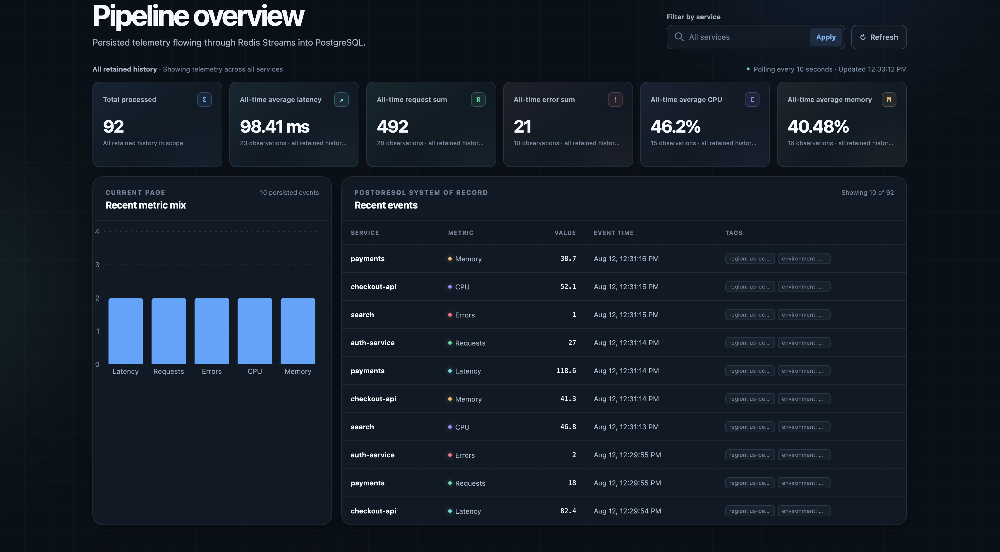
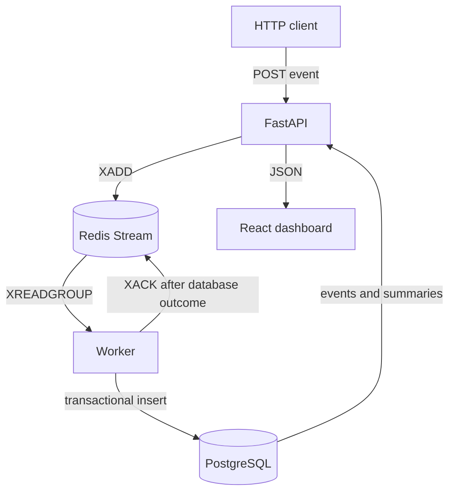

# EventStream

[](https://github.com/hamzaAhmed21st/eventstream/actions/workflows/ci.yml)

Send service metrics over HTTP, process them asynchronously, and explore the stored events in a React dashboard.

**FastAPI · Redis Streams · PostgreSQL · React · TypeScript · Docker Compose**

## Dashboard



[Run locally](#quick-start) · [Try a duplicate event](#five-minute-local-demo) · [Code and test evidence](docs/EVIDENCE.md)

## What happens to an event?

The API validates the payload and returns `202 Accepted` after Redis accepts it. A consumer-group worker then writes it to PostgreSQL, and the dashboard queries the stored results.

- **An exact replay keeps one database row.** Client-generated event IDs and a database uniqueness constraint handle repeated submissions.
- **A conflicting payload preserves the original event.** The worker detects the reused ID, logs the conflict, and acknowledges that delivery.
- **A database failure leaves the delivery pending.** Acknowledgment follows a successful commit or duplicate/conflict verification. Automatic recovery of pending messages is still future work.

The [integration tests](backend/tests/integration/test_pipeline.py) exercise real Redis and PostgreSQL. A separate [Compose smoke test](.github/workflows/ci.yml) submits an event, checks persistence and replay behavior, and queries through the frontend proxy. See the [test details](docs/EVIDENCE.md#recorded-ci-evidence).

## Architecture



PostgreSQL supplies the query results. The dashboard polls every ten seconds and displays API errors when requests fail. [Architecture details](docs/architecture.md).

## Stack

- Python 3.14.6, uv, FastAPI, Pydantic v2, SQLAlchemy 2, Alembic, psycopg 3, and redis-py
- PostgreSQL 17 and Redis 7.4 Streams
- React 19, TypeScript, Vite, TanStack Query, Recharts, Vitest, and Testing Library
- Ruff, mypy, pytest, pnpm, Docker Compose, and GitHub Actions

## Quick start

Prerequisites are Python 3.14.6 through uv, Node.js 24 (as used in CI), pnpm 11.20.0, Docker Desktop with Compose,
and `make`.

```bash
cp .env.example .env
make setup
docker compose up --build
```

Compose starts PostgreSQL, Redis, the API, worker, and frontend. The API applies Alembic
migrations before starting. Services are published on loopback only.

| Resource | URL |
| --- | --- |
| Dashboard | <http://localhost:5173> |
| OpenAPI UI | <http://localhost:8000/docs> |
| Liveness | <http://localhost:8000/health/live> |
| Readiness | <http://localhost:8000/health/ready> |

Stop the stack without removing its named volumes:

```bash
make down
```

EventStream is a local-development MVP. Its loopback-only defaults use simple local credentials
and do not provide a production authentication or security boundary; do not expose them to an
untrusted network.

## Metric contract

Every request requires a client-generated `event_id`, a normalized service name, a supported
metric, a finite metric value, a timezone-aware timestamp, and schema version `1`.

| Metric | Unit | Accepted value |
| --- | --- | --- |
| `latency_ms` | milliseconds | 0 through 86,400,000 |
| `request_count` | count | whole numbers from 0 through 1,000,000,000 |
| `error_count` | count | whole numbers from 0 through 1,000,000,000 |
| `cpu_usage` | percent | 0 through 100 |
| `memory_usage` | percent | 0 through 100 |

The API normalizes services and timestamps, bounds string tags, and rejects invalid or non-finite
values. PostgreSQL independently enforces event identity and the persisted metric invariants.

## API and retry semantics

Submit one event with a stable identifier:

```bash
curl --fail-with-body -X POST http://localhost:8000/api/v1/events \
  -H 'Content-Type: application/json' \
  -d '{
    "event_id": "018f62d0-65f2-7b3f-8c2d-72e981985c3a",
    "service": "checkout",
    "metric_name": "latency_ms",
    "value": 84.2,
    "timestamp": "2026-08-09T18:00:00Z",
    "tags": {"environment": "local"},
    "schema_version": 1
  }'
```

Redis publication failures return `503`; validation failures return `422`.

For a retry, send the same complete payload with the same `event_id`. Redis may receive another
entry, but the database keeps one canonical row. Reusing that identifier with different client
fields is an idempotency conflict: it is detected asynchronously by the worker, the original row
is preserved, and the permanently invalid message is logged and acknowledged. Because detection
happens after stream acceptance, the conflict is not reflected in the HTTP response. Never reuse
an identifier for a different logical event.

The query API lists persisted events with service, metric, and time filters and returns
unit-specific metric summaries. The dashboard polls readiness, recent events, and all five
summaries every ten seconds; cards cover all retained history in the selected service scope.

## Five-minute local demo

With the stack running, check dependency readiness:

```bash
curl --fail http://localhost:8000/health/ready
```

Send the API example above twice to exercise exact replay, then add traffic with seeded metric
content and fresh event identities:

```bash
make seed SEED_COUNT=20 SEED_RATE=10 SEED_RANDOM=42
```

Inspect the persisted path:

```bash
docker compose exec -T redis redis-cli XLEN eventstream:events
docker compose exec -T redis redis-cli XINFO GROUPS eventstream:events
docker compose exec -T postgres psql -U eventstream -d eventstream \
  -c 'SELECT event_id, service, metric_name, value FROM metric_events ORDER BY id DESC LIMIT 10;'
curl --fail 'http://localhost:8000/api/v1/events?page=1&page_size=10'
curl --fail 'http://localhost:8000/api/v1/metrics/summary?metric_name=latency_ms'
```

Open <http://localhost:5173> to see those PostgreSQL-backed summaries and recent events. The
synthetic generator seeds metric choices, values, services, and tags, but creates a fresh UUID and
live timestamp for every event. Repeating a seed therefore appends new events instead of reusing
identifiers. It produces demonstration traffic, not a benchmark.

## Tests and CI

The main local quality gate is:

```bash
make verify
```

It runs Ruff, ESLint, mypy, TypeScript checking, backend tests against isolated PostgreSQL and
Redis resources, frontend tests, the production frontend build, and Compose configuration
validation. Useful focused commands include `make test-backend`, `make test-frontend`,
`make lint`, and `make typecheck`.

GitHub Actions repeats locked dependency, lint, type, test, migration, frontend-build, container,
and real Compose event-path checks. Integration tests use `eventstream_test` and Redis database
15; they must never target normal development data.

## Current scope

This is a local metrics pipeline with duplicate-safe persistence. Pending-message recovery, alerting, and production load benchmarks are not implemented. The dashboard's latency card summarizes submitted `latency_ms` values; it does not measure this pipeline's processing latency. See [implementation and test limits](docs/EVIDENCE.md#current-boundaries) and the [roadmap](ROADMAP.md).
