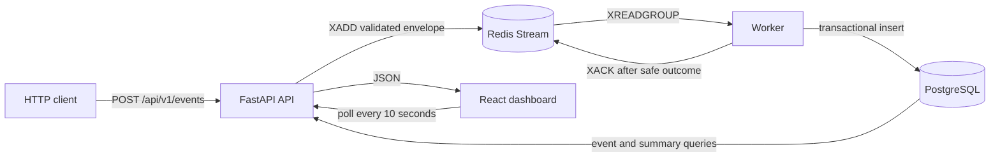

# EventStream architecture

## System view



FastAPI owns request validation and publication. Redis is the asynchronous handoff boundary.
The worker owns stream consumption and persistence. PostgreSQL is the query system of record.
The React application renders API responses and exposes failures instead of inventing fallback
metrics.

## Component responsibilities

- **Client:** assigns one stable UUID to a logical event and reuses both the identifier and full
  payload for retries.
- **API:** normalizes and validates the versioned event, wraps it with `received_at`, publishes
  one JSON field to the configured stream, and exposes health and query routes.
- **Redis:** accepts stream entries and delivers new entries through a consumer group. Local AOF
  uses `appendfsync everysec`; acceptance is not synchronous replication or proof of database
  persistence.
- **Worker:** performs blocking group reads, validates the envelope again, classifies persistence
  outcomes, and acknowledges only after a safe outcome.
- **PostgreSQL:** enforces event identity and metric invariants, stores canonical records, and
  serves filtered lists and aggregates.
- **Dashboard:** polls readiness, five unit-specific summaries, and the first ten recent events,
  optionally filtered by normalized service.

## Event contract and database invariants

| Field | Invariant |
| --- | --- |
| `event_id` | Required client UUID; unique in `metric_events` |
| `service` | Non-empty, at most 128 characters, trimmed and lowercased |
| `metric_name` | `latency_ms`, `request_count`, `error_count`, `cpu_usage`, or `memory_usage` |
| `value` | Finite and within the selected metric's unit-specific bounds |
| `timestamp` | Timezone-aware at ingestion and normalized to UTC |
| `tags` | JSON object with at most 20 string pairs; keys ≤64 and values ≤256 characters |
| `schema_version` | Exactly `1` |

The value ranges are 0–86,400,000 milliseconds for `latency_ms`, whole-number counts from 0–1
billion for `request_count` and `error_count`, and 0–100 percent for `cpu_usage` and
`memory_usage`. PostgreSQL check constraints enforce the supported name, version, normalized
service, JSON object, and metric/value relationship. A unique constraint protects `event_id`;
indexes support service, metric, event time, and combined service/metric/time queries.

## Processing sequence

```mermaid
sequenceDiagram
    participant Client
    participant API
    participant Redis
    participant Worker
    participant PostgreSQL

    Client->>API: POST event with stable event_id
    API->>API: normalize and validate
    API->>Redis: XADD canonical envelope
    Redis-->>API: stream entry id
    API-->>Client: 202 Accepted
    Worker->>Redis: XREADGROUP BLOCK
    Redis-->>Worker: pending stream entry
    Worker->>PostgreSQL: INSERT in transaction
    alt new event
        PostgreSQL-->>Worker: commit
        Worker->>Redis: XACK
    else existing event_id and same client fields
        PostgreSQL-->>Worker: exact replay confirmed
        Worker->>Redis: XACK
    else existing event_id and different client fields
        PostgreSQL-->>Worker: identifier conflict confirmed
        Worker->>Worker: log permanent conflict
        Worker->>Redis: XACK
    else database failure
        PostgreSQL-->>Worker: rollback/error
        Note over Worker,Redis: no XACK; entry remains pending
    end
```

The HTTP/Redis boundary is deliberate: `202 Accepted` says only that the running Redis instance
accepted the entry. A publish failure returns `503`, while request validation fails with `422`.
The client cannot infer PostgreSQL state from the 202 response.

## Idempotency and acknowledgement policy

An insert is attempted before duplicate classification. If `event_id` violates the unique
constraint, the transaction rolls back and the worker fetches the existing row. It compares the
normalized service, metric name, numeric value, event timestamp, tags, and schema version:

- An **exact replay** is safe. The original row remains canonical, and the stream entry is
  acknowledged.
- An **idempotency conflict** reuses the identifier with different client fields. The original
  row remains unchanged. The conflict is logged and acknowledged because retrying the same
  permanently invalid entry cannot resolve the identity mismatch.
- An unrelated integrity or database error is raised and left pending.

`received_at` and `processed_at` are processing metadata and are not part of the client identity
comparison. A crash after the database commit but before `XACK` can leave an exact replay
pending; uniqueness prevents a second row if that entry is delivered again. Automatic pending
recovery is not currently implemented.

Malformed stream envelopes are also left pending for diagnosis. If `XACK` itself fails after a
safe database outcome, the entry remains pending and the worker records the acknowledgement
failure.

## Read and dashboard path

`GET /api/v1/events` reads PostgreSQL in descending event-time and row-id order. It supports
service, metric, and inclusive start/end filters, page numbers 1–1,000, and page sizes 1–100.
Pagination is offset-based.

`GET /api/v1/metrics/summary` requires one metric name, preserving unit meaning while calculating
count, minimum, maximum, average, sum, and most-recent value. Optional service and time filters
use the same normalization rules as the event list.

The dashboard requests the first ten events plus one summary for each supported metric. With no
time filter, summary cards represent all retained history in the selected service scope. The
dashboard shows readiness, loading, empty, error, and success states and polls every ten seconds.

## Failure boundaries and tradeoffs

- Invalid HTTP input never reaches Redis.
- Redis unavailability prevents acceptance; accepted entries still inherit local AOF's possible
  loss window.
- Invalid stream payloads and database failures remain pending, but there is no automatic claim,
  bounded retry, or dead-letter path yet.
- A permanently conflicting identifier is acknowledged to prevent one poison entry from staying
  pending indefinitely; operators currently rely on structured logs for evidence.
- Readiness tests PostgreSQL and Redis connectivity. It does not report worker liveness, consumer
  lag, or end-to-end freshness. Liveness is process-only.
- Raw-event summaries and offset pagination are simple and truthful for the MVP, but they do not
  provide a shared snapshot across separate dashboard requests.
- Query failures produce an explicit browser error state; stale or fabricated fallback values are
  not displayed.

Planned reliability, consistency, observability, contract, security, and delivery work is listed
once in [the roadmap](../ROADMAP.md).
