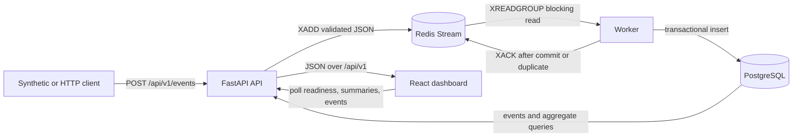

# EventStream MVP architecture

## System view



FastAPI owns validation and stream publication. Redis decouples acceptance from persistence. The worker owns consumer-group processing and database durability. PostgreSQL is the query system of record. The React application displays only values obtained from the API.

## Component responsibilities

- **Client/generator:** creates stable UUIDs, UTC timestamps, realistic service metrics, and reports accepted versus failed submissions.
- **API:** normalizes service names and timestamps, enforces the versioned schema and tag/value limits, publishes one event, exposes dependency health, and queries persisted data.
- **Redis Stream:** queues accepted events for a named consumer group. Local AOF uses `appendfsync everysec`, which supports restart recovery but is not a zero-loss or synchronously replicated durability guarantee. An entry remaining pending signals unfinished processing.
- **Worker:** blocks for new entries, parses the canonical payload, persists it transactionally, treats an existing `event_id` as success, acknowledges only after durability, logs structured outcomes, and shuts down cleanly.
- **PostgreSQL:** enforces event uniqueness, stores event metadata and timestamps, and serves indexed filtered/aggregate queries.
- **Dashboard:** polls API health, metric summaries, and recent events; applies a service filter; and presents loading, empty, success, and error states accessibly.
- **Compose:** supplies local service discovery, health checks, startup ordering, safe defaults, and persistent development volumes.

## Event-processing sequence

```mermaid
sequenceDiagram
    participant Client
    participant API
    participant Redis
    participant Worker
    participant PostgreSQL
    participant Dashboard

    Client->>API: POST validated metric event
    API->>Redis: XADD event payload
    Redis-->>API: stream entry id
    API-->>Client: 202 Accepted (queued, not persisted)
    Worker->>Redis: XREADGROUP BLOCK
    Redis-->>Worker: stream entry
    Worker->>PostgreSQL: INSERT in transaction
    alt new event
        PostgreSQL-->>Worker: commit succeeds
        Worker->>Redis: XACK
    else duplicate event_id
        PostgreSQL-->>Worker: unique violation / existing row
        Worker->>Redis: XACK after duplicate confirmation
    else database failure
        PostgreSQL-->>Worker: rollback
        Note over Worker,Redis: no acknowledgement; message stays pending
    end
    Dashboard->>API: poll events and summaries
    API->>PostgreSQL: indexed queries
    PostgreSQL-->>API: persisted results
    API-->>Dashboard: real response data
```

## Failure boundaries

- Invalid input fails before Redis and receives a 4xx response.
- Redis publication failure prevents HTTP 202; the client may retry with the same `event_id`.
- HTTP 202 confirms acceptance by the running Redis instance only. It does not prove PostgreSQL persistence, synchronous disk flush, replication, or zero-loss durability.
- A worker parse or database error is logged and left unacknowledged. The MVP does not yet reclaim pending messages automatically.
- A worker crash after commit but before acknowledgement can leave the entry pending. The database unique constraint makes a later manual or future replay safe to deduplicate, but the current worker does not reclaim or redeliver it automatically.
- Readiness returns failure when PostgreSQL or Redis cannot be reached, while liveness remains process-only.
- Query/API failure produces an explicit dashboard error state; stale or invented fallback metrics are not shown.

## Current MVP limitations

- New consumer-group messages are processed, but pending entries are not automatically claimed after a worker failure.
- There are no retry ceilings, backoff policy, dead-letter stream, or worker heartbeat.
- Aggregates are calculated from raw events at query time; there are no rollup tables or sliding windows.
- Polling provides eventual UI updates; WebSockets and SSE are absent.
- The local stack has safe development credentials but no application authentication or multi-tenant isolation.
- Metrics are accepted individually; batching and formal performance claims are outside this MVP.

## Planned reliability improvements

Add `XAUTOCLAIM`-based pending recovery with delivery counters, bounded exponential retry, a dead-letter stream with operator tooling, worker heartbeat/lag metrics, graceful draining, and end-to-end tracing. Later data work can add time-window rollups, retention, alert state machines, and authenticated tenant-aware APIs. These items are roadmap only and are not claimed as implemented.
